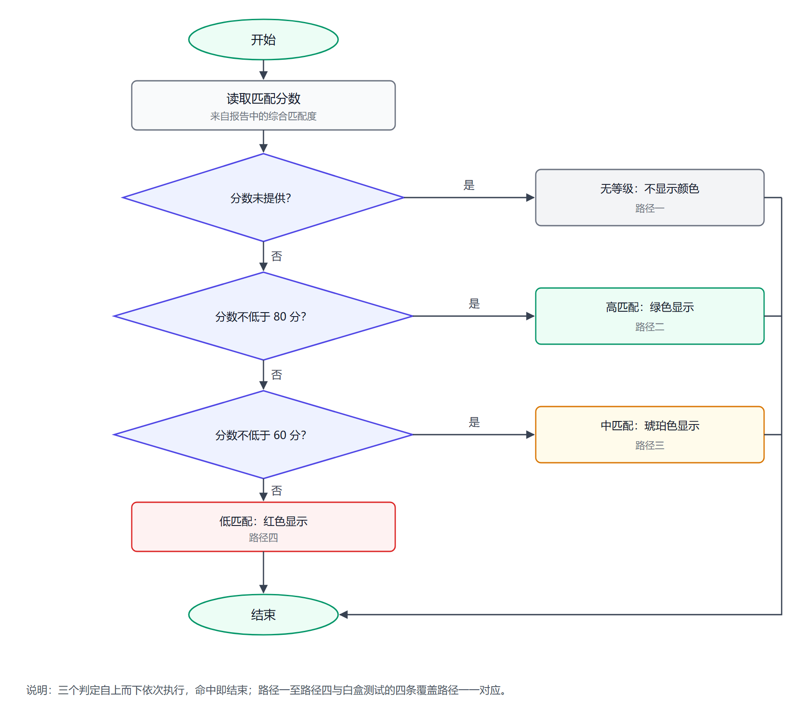

# 匹配分数判级函数 白盒测试报告

> 测试类型：白盒测试（结构化覆盖）
> 被测对象：前端「匹配分析」页面评分列里的匹配分数判级函数
> 测试结论：12 条用例全部通过；语句 7/7、判定分支 6/6、条件 4/4、路径 4/4，覆盖率 100%

---

## 1 被测对象

### 1.1 对象说明

| 项      | 内容                                                                       |
| ------ | ------------------------------------------------------------------------ |
| 名称     | 匹配分数判级函数                                                                 |
| 位置     | 前端「匹配分析」页面评分列，源码第 91–96 行（`NewRepo-main/frontend/src/pages/Matches.tsx`） |
| 形态     | 页面内部的纯函数：输入一个匹配分数，返回一个表示等级的样式类名                                          |
| 输入     | 0 到 100 的匹配分数；报告未完成或分析失败时没有分数（空值）                                        |
| 输出     | 绿色（高匹配）、琥珀色（中匹配）、红色（低匹配）、不染色（无等级）                                        |
| 被测内容   | 判级函数的全部语句、3 个判定、`或` 条件的两侧、4 条执行路径                                        |
| 不在本次范围 | 分数如何产生（由 AI 分析给出）、页面实际渲染效果、其他页面里重复的同类函数                                  |
| 测试类型   | 白盒测试：在真实源码上插桩统计覆盖率，不只看输入输出                                               |

### 1.2 被测源码

```ts
// frontend/src/pages/Matches.tsx:91-96
const getScoreColor = (score?: number) => {
  if (score === undefined || score === null) return '';
  if (score >= 80) return 'text-emerald-600';
  if (score >= 60) return 'text-amber-500';
  return 'text-destructive';
};
```

### 1.3 为什么选它作为被测对象

系统的综合匹配分由 AI 分析给出，代码里没有确定性的加权公式；整个系统里确定性的“评分”逻辑就是这段“分数 → 等级”的判定。它有三个判定、四条执行路径，且是纯函数（无 I/O、无随机、无时间），适合做白盒测试；它同时决定用户看到的分数颜色，属于需求中的“匹配度分级展示”。

---

## 2 测试依据：流程图



可编辑图源：[流程图.svg](流程图.svg)

流程图中的四条路径与测试用例一一对应：

| 路径  | 判定过程       | 结果       | 对应用例                |
| --- | ---------- | -------- | ------------------- |
| 路径一 | 分数未提供      | 无等级（不染色） | 用例07、用例08           |
| 路径二 | 分数不低于 80 分 | 高匹配（绿色）  | 用例01、用例02、用例10      |
| 路径三 | 分数不低于 60 分 | 中匹配（琥珀色） | 用例03、用例04、用例12      |
| 路径四 | 分数低于 60 分  | 低匹配（红色）  | 用例05、用例06、用例09、用例11 |

---

## 3 白盒测试方法

1. **取真实源码**：从 `Matches.tsx` 截取函数体，去掉 TypeScript 类型标注，不复制逻辑；
2. **插桩**：在每个语句、每个判定的两个出口、`或` 的两侧注入探针。单条语句的 `if` 会先补花括号再插桩，保证 `return` 仍受 `if` 约束，探针不改变语义；
3. **执行并断言**：跑 12 条用例，逐条核对返回的等级；
4. **统计覆盖**：语句覆盖、判定覆盖、条件覆盖、路径覆盖，并核对圈复杂度；
5. **通过准则**：断言全部通过，且四类覆盖率均为 100%，否则脚本退出码为 1。

插桩后的代码（节选）：

```js
__cov.stmt('语句1'); if (__cov.dec('判定1', (__cov.op('条件1', (score === undefined)) || __cov.op('条件2', (score === null))))) { __cov.stmt('语句2'); return ''; }
__cov.stmt('语句3'); if (__cov.dec('判定2', (score >= 80))) { __cov.stmt('语句4'); return 'text-emerald-600'; }
__cov.stmt('语句5'); if (__cov.dec('判定3', (score >= 60))) { __cov.stmt('语句6'); return 'text-amber-500'; }
__cov.stmt('语句7'); return 'text-destructive';
```

圈复杂度：节点 9 个、边 11 条，V(G) = 11 − 9 + 2 = 4；判定 3 个，V(G) = 3 + 1 = 4，与实测 4 条路径一致。

---

## 4 测试用例

| 用例   | 输入    | 期望结果     | 覆盖路径 | 设计依据             |
| ---- | ----- | -------- | ---- | ---------------- |
| 用例01 | 95    | 高匹配（绿）   | 路径二  | 高匹配典型值           |
| 用例02 | 80    | 高匹配（绿）   | 路径二  | 边界 80 分（含等号）     |
| 用例03 | 79.9  | 中匹配（琥珀）  | 路径三  | 80 分的下沿          |
| 用例04 | 60    | 中匹配（琥珀）  | 路径三  | 边界 60 分（含等号）     |
| 用例05 | 59.9  | 低匹配（红）   | 路径四  | 60 分的下沿          |
| 用例06 | 0     | 低匹配（红）   | 路径四  | 合法下界 0 分         |
| 用例07 | 未提供分数 | 无等级（不染色） | 路径一  | 报告未分析完           |
| 用例08 | 空值    | 无等级（不染色） | 路径一  | 接口返回空值           |
| 用例09 | −5    | 低匹配（红）   | 路径四  | 越界负值             |
| 用例10 | 120   | 高匹配（绿）   | 路径二  | 越界大于 100         |
| 用例11 | 非数值   | 低匹配（红）   | 路径四  | 非法数值             |
| 用例12 | 79.6  | 中匹配（琥珀）  | 路径三  | 显示取整为 80 但判级为中匹配 |

四条路径都有用例命中；80 分、60 分两个等号边界都有专门用例；空分数、越界值作为错误推测补充。

更细的分支覆盖（分支清单、判定表、覆盖矩阵、最小用例集）见 [分支覆盖用例.md](分支覆盖用例.md)，可机读版本见 [分支覆盖用例.csv](分支覆盖用例.csv)。

---

## 5 执行结果

运行方式：

```powershell
cd 判级函数白盒测试
node --no-warnings 白盒测试脚本.mjs
```

完整输出见 [执行结果.txt](执行结果.txt)，摘要如下：

| 覆盖类型      | 结果                      |
| --------- | ----------------------- |
| 用例        | 12 条，通过 12 条，失败 0 条     |
| 语句覆盖      | 7/7                     |
| 判定 / 分支覆盖 | 6/6（判定1、判定2、判定3 各取真、取假） |
| 条件覆盖      | 4/4（`或` 的两侧各取真、取假）      |
| 路径覆盖      | 4/4（路径一至路径四）            |
| 圈复杂度      | 4，与路径数一致                |

各路径的实际覆盖用例：

| 路径  | 覆盖用例                | 返回结果     |
| --- | ------------------- | -------- |
| 路径一 | 用例07、用例08           | 无等级（不染色） |
| 路径二 | 用例01、用例02、用例10      | 高匹配（绿色）  |
| 路径三 | 用例03、用例04、用例12      | 中匹配（琥珀色） |
| 路径四 | 用例05、用例06、用例09、用例11 | 低匹配（红色）  |

---

## 6 结论与局限

结论：

1. 判级函数的全部语句、全部判定分支、`或` 条件的两侧、四条执行路径都被执行到，覆盖率 100%；
2. 12 条用例的返回值全部符合预期，包括 80 / 60 的等号归属、0 分与 100 分端点、空分数不染色；
3. 实测路径数 4 与圈复杂度 4 一致，说明流程图与代码控制流一致。

局限：

- 只验证“给定分数如何分级”，不验证分数本身是否准确（分数由 AI 分析产生）；
- 不验证颜色在真实浏览器里的最终呈现（属于构建与视觉验收）；
- 不验证 80 / 60 两个阈值的业务合理性（属于需求决策）。

---

## 7 文件清单与复现

| 文件 | 用途 |
|---|---|
| [流程图.png](流程图.png) | 全中文流程图，可直接插入报告 |
| [流程图.svg](流程图.svg) | 可编辑图源，坐标与判定一一对应 |
| [分支覆盖用例.md](分支覆盖用例.md) | 分支覆盖专项设计：分支清单、判定表、覆盖矩阵、最小集 |
| [分支覆盖用例.csv](分支覆盖用例.csv) | 6 条分支覆盖用例，Excel 可直接打开 |
| [白盒测试脚本.mjs](白盒测试脚本.mjs) | 白盒测试脚本：插桩统计覆盖率、执行 12 条用例并断言 |
| [执行结果.txt](执行结果.txt) | 最近一次运行的完整输出，作为测试证据 |
| [导出图片.html](导出图片.html) | 仅用于把流程图导出为图片 |

复现：

```powershell
cd 判级函数白盒测试
node --no-warnings 白盒测试脚本.mjs
```

脚本会先输出【被测对象】与原函数，再输出用例执行表、四类覆盖表与结论；任一断言失败或覆盖率不足 100% 时退出码为 1。修改用例只需编辑脚本里的 `用例表` 数组。


