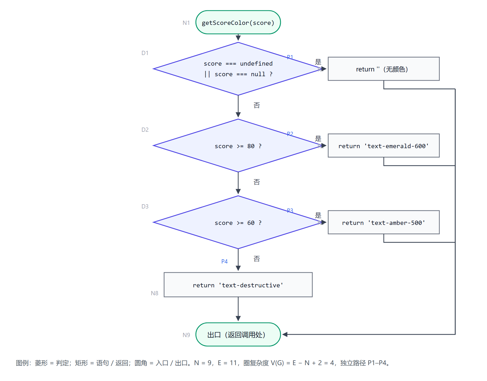

# 评分函数白盒分析：控制流图与分支覆盖用例

> 分析对象：SmartHire（`NewRepo-main`）
> 被测函数：`frontend/src/pages/Matches.tsx` 第 91–96 行 `getScoreColor(score?: number)`
> 结论：3 个判定、6 条判定分支、2 个逻辑操作数分支、4 条独立路径全部覆盖；12 条用例全部通过。

---

## 1 选择依据：系统里哪一个才是“评分函数”

系统的综合匹配分由 LLM 产生，代码里没有确定性的加权公式：

- `backend/app/agents/match_agent.py` 第 16–33 行只声明 `overall_score`、`skill_match_score`、`experience_match_score` 三个 0–100 的字段，提示词里写的是 “based on a weighted combination of factors”，真正的加权由模型完成；
- 后端只做结构约束（`ge=0.0, le=100.0`）与落库（`career.py` 第 188 行），`OrchestratorResult.overall_score` 只是取值。

所以“简历 → 分数”这一步没有可做确定性分支分析的代码；**系统里确定性的评分逻辑是“分数 → 等级”的判定**，即分数落在哪个区间、显示哪种颜色、缺分时是否显示。它在三处重复出现：

| 位置 | 函数 | 判定个数 | 特点 |
|---|---|---|---|
| `frontend/src/pages/Matches.tsx:91` | `getScoreColor` | 3 | 有缺失值守卫，控制流最完整 |
| `frontend/src/components/ScoreCard.tsx:10` | `getScoreColor` | 2 | 无守卫，`score` 默认 0 |
| `frontend/src/components/ScoreCard.tsx:16` | `getScoreRing` | 2 | 与上一行同构，只换返回值 |

选 `Matches.tsx` 的 `getScoreColor` 作为被测函数，理由：

1. 它是**纯函数**——只依赖入参，没有 I/O、随机数、时间、全局状态，白盒结论可复现；
2. 3 个判定、4 条独立路径，是这组函数里控制流最完整的一支（`ScoreCard` 版把缺失值折叠成 0，少一个判定）；
3. 它直接决定列表页“综合评分”列的颜色，是需求“匹配度分级展示”的实现点，测试价值明确。

`ScoreCard` 的两个同名/同构函数可作为回归时的“重复实现”提示，见第 7.3 节。

### 被测代码

```tsx
// frontend/src/pages/Matches.tsx:91-96
const getScoreColor = (score?: number) => {
  if (score === undefined || score === null) return '';   // D1 缺分守卫
  if (score >= 80) return 'text-emerald-600';              // D2 高匹配
  if (score >= 60) return 'text-amber-500';                // D3 中匹配
  return 'text-destructive';                               // 低匹配
};
```

调用现场（同文件 218–224 行）：只有 `overall_score !== null && !== undefined` 时才调用它，并把分数用 `Math.round` 四舍五入后显示。

---

## 2 控制流图



可编辑源文件：[评分函数控制流图.svg](assets/评分函数控制流图.svg)

### 2.1 节点

| 节点 | 类型 | 内容 |
|---|---|---|
| N1 | 入口 | `getScoreColor(score)` |
| D1 | 判定 | `score === undefined` 或 `score === null` ? |
| R1 | 返回 | `return ''`（无颜色） |
| D2 | 判定 | `score >= 80 ?` |
| R2 | 返回 | `return 'text-emerald-600'`（高匹配，绿） |
| D3 | 判定 | `score >= 60 ?` |
| R3 | 返回 | `return 'text-amber-500'`（中匹配，琥珀） |
| N8 | 返回 | `return 'text-destructive'`（低匹配，红） |
| N9 | 出口 | 返回调用处 |

### 2.2 边

| 边 | 从 → 到 | 条件 |
|---|---|---|
| e1 | N1 → D1 | 无条件 |
| e2 | D1 → R1 | D1 为真（是） |
| e3 | D1 → D2 | D1 为假（否） |
| e4 | D2 → R2 | D2 为真（是） |
| e5 | D2 → D3 | D2 为假（否） |
| e6 | D3 → R3 | D3 为真（是） |
| e7 | D3 → N8 | D3 为假（否） |
| e8 | R1 → N9 | 无条件 |
| e9 | R2 → N9 | 无条件 |
| e10 | R3 → N9 | 无条件 |
| e11 | N8 → N9 | 无条件 |

### 2.3 圈复杂度

- 节点数 N = 9，边数 E = 11；
- **V(G) = E − N + 2 = 11 − 9 + 2 = 4**；
- 判定节点数 P = 3，V(G) = P + 1 = 4，与上式一致。

因此独立路径为 4 条，路径覆盖至少需要 4 条用例：

| 路径 | 节点序列 | 条件 | 返回 | 典型输入 |
|---|---|---|---|---|
| P1 | N1 → D1 → R1 → N9 | 分数缺失 | `''` | `undefined` |
| P2 | N1 → D1 → D2 → R2 → N9 | `score ≥ 80` | `'text-emerald-600'` | `95` |
| P3 | N1 → D1 → D2 → D3 → R3 → N9 | `60 ≤ score < 80` | `'text-amber-500'` | `70` |
| P4 | N1 → D1 → D2 → D3 → N8 → N9 | `score < 60` | `'text-destructive'` | `30` |

---

## 3 判定与分支清单

| 判定 | 代码 | 真分支 | 假分支 |
|---|---|---|---|
| D1 | `score === undefined` 或 `score === null`（源码用逻辑或连接） | → R1 | → D2 |
| D2 | `score >= 80` | → R2 | → D3 |
| D3 | `score >= 60` | → R3 | → N8 |

D1 是复合条件，拆开还有两个“逻辑操作数”，短路求值使它们各自是一条可独立覆盖的分支：

| 操作数 | 表达式 | 说明 |
|---|---|---|
| L1 | `score === undefined` | 为真时直接短路，L2 不求值 |
| L2 | `score === null` | 只有 L1 为假时才求值 |

> 口径说明：多数教材的“分支覆盖”等同于“判定覆盖”，即上表 6 条判定分支；而 Istanbul / `@vitest/coverage-v8` 会把 `||` 的左右操作数各算一个 branch，多出 L1、L2 两条。本报告两套口径都给出，避免把覆盖率数字说得比实际更好看。

---

## 4 分支覆盖用例设计

设计思路：先按等价类取典型值，再对边界两侧各取一个值（80 与 79.9、60 与 59.9），最后补缺失值、越界值和非法数值；每个用例都标注它命中的分支和路径。

| 用例 | 输入 | 期望返回 | 覆盖分支 | 路径 | 设计依据 |
|---|---|---|---|---|---|
| TC01 | `95` | `'text-emerald-600'` | D1-F, D2-T | P2 | 等价类：高匹配典型值 |
| TC02 | `80` | `'text-emerald-600'` | D1-F, D2-T | P2 | 边界：`>= 80` 的等号侧 |
| TC03 | `79.9` | `'text-amber-500'` | D1-F, D2-F, D3-T | P3 | 边界：80 的下沿 |
| TC04 | `60` | `'text-amber-500'` | D1-F, D2-F, D3-T | P3 | 边界：`>= 60` 的等号侧 |
| TC05 | `59.9` | `'text-destructive'` | D1-F, D2-F, D3-F | P4 | 边界：60 的下沿 |
| TC06 | `0` | `'text-destructive'` | D1-F, D2-F, D3-F | P4 | 合法下界 |
| TC07 | `undefined` | `''` | D1-T, L1 | P1 | 缺分：未分析完的报告 |
| TC08 | `null` | `''` | D1-T, L2 | P1 | 缺分：JSON 里的 `null`（类型外输入） |
| TC09 | `-5` | `'text-destructive'` | D1-F, D2-F, D3-F | P4 | 越界负值，验证无范围防御 |
| TC10 | `120` | `'text-emerald-600'` | D1-F, D2-T | P2 | 越界大于 100，验证无上限防御 |
| TC11 | `NaN` | `'text-destructive'` | D1-F, D2-F, D3-F | P4 | 非法数值，比较恒为假 |
| TC12 | `79.6` | `'text-amber-500'` | D1-F, D2-F, D3-T | P3 | 显示四舍五入为 80，但判级仍为琥珀 |

**最小分支覆盖集合：TC02、TC04、TC05、TC07、TC08。** 其中 TC02/TC04/TC05 覆盖 6 条判定分支，TC07/TC08 覆盖 L1/L2 与 P1。若只按教材口径（6 条判定分支）统计，TC02、TC04、TC05、TC07 四条即可。TC01、TC03、TC06 属于等价类内的冗余用例，TC09–TC12 是越界与边界一致性用例，保留它们是为了暴露第 7 节的问题，而不是为了刷覆盖率。

### 覆盖矩阵

● 表示该用例命中该分支。

| 用例 | D1-T | D1-F | D2-T | D2-F | D3-T | D3-F | L1 | L2 |
|---|:--:|:--:|:--:|:--:|:--:|:--:|:--:|:--:|
| TC01 | | ● | ● | | | | | |
| TC02 | | ● | ● | | | | | |
| TC03 | | ● | | ● | ● | | | |
| TC04 | | ● | | ● | ● | | | |
| TC05 | | ● | | ● | | ● | | |
| TC06 | | ● | | ● | | ● | | |
| TC07 | ● | | | | | | ● | |
| TC08 | ● | | | | | | | ● |
| TC09 | | ● | | ● | | ● | | |
| TC10 | | ● | ● | | | | | |
| TC11 | | ● | | ● | | ● | | |
| TC12 | | ● | | ● | ● | | | |
| **命中** | ● | ● | ● | ● | ● | ● | ● | ● |

---

## 5 实际执行结果

用例执行器：[tests/getScoreColor.branch.mjs](tests/getScoreColor.branch.mjs)。它不复制被测逻辑，而是从 `Matches.tsx` 中截取 `getScoreColor` 的函数体，去掉类型标注后原样执行：

```powershell
node --no-warnings tests/getScoreColor.branch.mjs
```

实测输出（完整记录见 [tests/运行结果.txt](tests/运行结果.txt)）：

```text
被测源文件：NewRepo-main/frontend/src/pages/Matches.tsx  第 91 行起
总计：12 条用例，通过 12 条，失败 0 条。
判定分支：6/6
逻辑操作数：2/2
独立路径：4/4（V(G) = 4）
结论：全部判定分支均已覆盖（100%）。
```

每条用例的实际返回值都与期望一致；分支命中由返回值反推——四个分支的返回值互不相同（`''`、`text-emerald-600`、`text-amber-500`、`text-destructive`），因此这种反推是唯一且可观测的，不是对代码的二次推断。

说明：项目当前没有接入 Vitest/c8（`frontend/package.json` 只有 `dev/build/preview` 三个脚本），所以用 Node 写了一个轻量测试桩；它执行的是源文件里的真实函数体，而不是对照抄写的一份副本。接入正式框架的改造建议见第 8 节。

---

## 6 这类用例能证明什么、不能证明什么

能证明：

- 4 个出口都被执行到，语句覆盖 100%；
- 3 个判定的真假两侧、`||` 的两个操作数都被执行到，判定/分支覆盖 100%；
- 4 条独立路径（等于圈复杂度）都可执行，路径覆盖 100%；
- 阈值取等号时（80、60）归入高/中档，取等号下沿（79.9、59.9）归入下一档，符合“高匹配、中匹配、低匹配”的区间定义。

不能证明：

- 分数本身的正确性——分数由 LLM 给出，这里只验证“给定分数如何分级”；
- 颜色在真实浏览器里的最终呈现（Tailwind 类是否被正确生成、主题色是否可用），这属于构建与视觉验收；
- 阈值 80/60 的业务合理性，这是需求决策，不是代码缺陷。

---

## 7 用例暴露的三个问题

### 7.1 显示值与判级值不一致（真实缺陷）

列表页显示的是 `Math.round(score)`，判级用的是未取整的原始值。于是：

| 分数 | 显示 | 颜色 | 观感 |
|---|---|---|---|
| 79.6 | `80` | 琥珀（中匹配） | 显示 80 分却是黄色 |
| 59.6 | `60` | 红（低匹配） | 显示 60 分却是红色 |

TC12 就是为了锁定这个行为。修复方向二选一：判级前先 `Math.round`（显示与判级同源），或显示保留一位小数（`toFixed(1)`）；不要两处各取一套。

### 7.2 没有范围防御

`120` 判为绿色、`-5` 和 `NaN` 判为红色。目前后端 Pydantic 已用 `ge=0, le=100` 约束了 `overall_score`，所以正常链路进不来越界值；但前端函数自身没有 0–100 的断言或钳制，一旦换数据源或绕过 Schema，展示会失真。属于“契约内可接受、契约外未定义”，建议在函数注释里写明前置条件，或在入口 `Math.min(100, Math.max(0, score))`。

### 7.3 阈值逻辑三处重复，且缺失值语义不一致

| 位置 | 缺失值（undefined） | 结果 |
|---|---|---|
| `Matches.tsx` `getScoreColor` | 返回 `''` | 不染色 |
| `ScoreCard.tsx` `getScoreColor` | 默认参数 0 | 红色 |

同一份“80/60 分档”规则被抄了三份，改阈值时必须同时改三处，改漏一处就会出现列表页和详情页颜色不一致。建议抽成 `frontend/src/lib/score.ts`：

```ts
export type ScoreLevel = 'excellent' | 'medium' | 'low' | 'unknown';

export function scoreLevel(score?: number | null): ScoreLevel {
  if (score === undefined || score === null || Number.isNaN(score)) return 'unknown';
  if (score >= 80) return 'excellent';
  if (score >= 60) return 'medium';
  return 'low';
}

export function scoreColor(score?: number | null): string { /* 由 Level 映射类名 */ }
```

UI 只负责把 Level 映射成类名，判级规则单一真源，也能被单元测试直接导入。

---

## 8 复现方式与后续建议

```powershell
# 1. 只看结论
node --no-warnings tests/getScoreColor.branch.mjs

# 2. 改了源码后重跑，用例表与覆盖率会随之更新
# 3. 改了 SVG 后重新导出 PNG（本机无 graphviz/plantuml，用无头 Edge 截图）
& "C:\Program Files (x86)\Microsoft\Edge\Application\msedge.exe" `
  --headless=new --no-sandbox --screenshot=assets/评分函数控制流图.png `
  --window-size=920,720 --force-device-scale-factor=2 assets/render.html
```

正式接入建议：

1. 按第 7.3 节把判级逻辑抽到 `src/lib/score.ts` 并导出；
2. 安装 `vitest` + `@vitest/coverage-v8`，把本文 12 条用例改写成 `describe/it`，断言 `scoreLevel` 与 `scoreColor`；
3. 覆盖率门槛设为 100% branches，在 CI 里跑；由于函数已无 I/O，用例执行时间可以忽略；
4. 删除页面里重复的 `m.overall_score !== null && !== undefined` 守卫，改为在 `scoreLevel` 内部统一处理，避免“类型上不可达、却为它写了一个分支”的 L2 情况——那是当前唯一需要靠类型外输入（`null as any`）才能覆盖的分支。

---

## 附录 交付物清单

| 文件 | 用途 |
|---|---|
| [评分函数控制流图.png](assets/评分函数控制流图.png) | 可直接插入报告的 CFG 图（1840×1440，2 倍图） |
| [评分函数控制流图.svg](assets/评分函数控制流图.svg) | 可编辑图源，坐标与节点/边表一一对应 |
| [tests/getScoreColor.branch.mjs](tests/getScoreColor.branch.mjs) | 用例执行器，直接从源码取函数，含 12 条断言与覆盖率统计 |
| [tests/运行结果.txt](tests/运行结果.txt) | 最近一次运行的真实输出，附在报告里作为测试证据 |
| [assets/render.html](assets/render.html) | SVG → PNG 的截图包装页，仅用于导出图片 |
