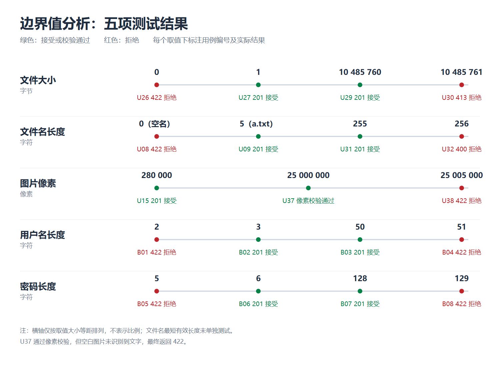

# SmartHire 简历上传与账号认证接口 黑盒测试报告

> **测试类型**：黑盒测试（等价类划分 + 边界值分析 + 错误推测）
>
> **被测系统**：SmartHire 智能招聘辅助系统（项目根目录）
>
> **被测对象**：① 简历上传接口 `POST /api/v1/resumes/upload`；② 账号认证接口 `POST /api/v1/auth/register`、`POST /api/v1/auth/login`
>
> **测试结论**：65 条用例全部通过。3 个数值边界（10 MB 文件、2 500 万像素、255 字符文件名）和 2 个长度区间（用户名 3–50、密码 6–128）的实测结果都落在需求规定的一侧；未发现与需求冲突的缺陷。

---

## 1 被测对象

### 1.1 为什么选这两个接口

黑盒测试只能依据“输入 → 可观察输出”，所以被测对象必须有明确的输入、明确的输出和可判定的预期。SmartHire 是“简历 → 岗位 → 匹配 → 报告”的招聘辅助系统，其中真正由程序规则（而不是由大模型判断）决定的行为集中在两个入口：

- **简历上传接口**：文件类型、大小、像素、文件名、身份五类输入全部有确定规则，且不配置 DeepSeek Key 也能完整执行（只做文本提取）；
- **账号认证接口**：用户名/密码长度、邮箱格式、角色枚举、唯一性、停用状态都是确定规则，是进入系统的第一道门。

其余接口（岗位分析、匹配分析、报告生成）的核心结果由 AI 生成，输入输出不是确定映射，不适合作为本次黑盒的判定对象；它们放在第 7 节“局限”里说明。下文源码路径均指向项目根目录内的文件。

### 1.2 对象 U：简历上传接口

| 项      | 内容                                                                                                                                                                       |
| ------ | ------------------------------------------------------------------------------------------------------------------------------------------------------------------------ |
| 名称     | 简历上传接口 `upload_resume`                                                                                                                                                   |
| 位置     | 后端 [resumes.py:129](../../backend/app/api/v1/resumes.py#L129)；前端入口 [Resumes.tsx:99](../../frontend/src/pages/Resumes.tsx#L99) 的隐藏文件选择框（`accept` 白名单） |
| 形态     | HTTP `POST /api/v1/resumes/upload`，`multipart/form-data`，文件字段名 `file`                                                                                                    |
| 输入     | ① `Authorization: Bearer <access token>`；② 文件字节内容；③ 文件名（含扩展名）；④ 文件大小；⑤ 图片的像素尺寸                                                                                           |
| 输出     | `201` 上传成功（返回 `id`、`title`、`status=PARSED`、`message`）；`400` 扩展名或文件名非法；`401` 未认证/令牌无效；`413` 超过 10 MB；`422` 解析失败（无文字、图片损坏、格式不支持、像素超限）                                      |
| 可见后置条件 | 成功时简历列表新增 1 条记录、上传目录新增 1 个文件；失败时不新增记录、不残留文件                                                                                                                              |
| 需求依据   | FR03（支持 PDF、DOCX、TXT、Markdown 与图片）、FR05（非法/空白图片被拒绝且不保留记录）、NFR02（单文件 10 MB、图片 2 500 万像素）、UC02（异常场景 400/413/422）                                                           |
| 不在本次范围 | OCR 识别准确率、AI 结构化解析质量、前端页面渲染效果、并发与吞吐                                                                                                                                      |

### 1.3 对象 B：账号认证接口

| 项      | 内容                                                                                                                                                                                                                                                                |
| ------ | ----------------------------------------------------------------------------------------------------------------------------------------------------------------------------------------------------------------------------------------------------------------- |
| 名称     | 注册 `register`、登录 `login`                                                                                                                                                                                                                                          |
| 位置     | 后端 [auth.py:26](../../backend/app/api/v1/auth.py#L26)（注册）、[auth.py:74](../../backend/app/api/v1/auth.py#L74)（登录）；前端 [Register.tsx](../../frontend/src/pages/Register.tsx)、[Login.tsx](../../frontend/src/pages/Login.tsx) |
| 形态     | HTTP `POST`，`application/json`                                                                                                                                                                                                                                    |
| 输入（注册） | `username`、`email`、`password`、`role`（可省略）                                                                                                                                                                                                                         |
| 输入（登录） | `username`、`password`                                                                                                                                                                                                                                             |
| 输出     | 注册：`201` 返回用户信息；`409` 用户名或邮箱已存在；`422` 字段校验失败。登录：`200` 返回 `access_token`、`refresh_token`、`token_type=bearer`；`401` 凭证错误；`403` 账号停用；`422` 字段缺失                                                                                                                      |
| 需求依据   | FR01（可注册、可登录，未认证访问被拒绝）、NFR01（认证与角色由后端检查）                                                                                                                                                                                                                          |
| 不在本次范围 | 刷新令牌端点（系统未实现）、找回密码、密码强度策略、JWT 签名算法安全性、暴力破解限流                                                                                                                                                                                                                      |

### 1.4 黑盒的观察边界

本次测试**不阅读被测函数的分支代码**，只看四类外部可观察结果：

1. HTTP 状态码；
2. 响应体中的错误信息（`detail`）；
3. 后续查询接口能否看到刚才的记录（`GET /api/v1/resumes/`）；
4. 上传目录的文件数量变化。

“期望结果”来自需求文档（FR/NFR/UC）与接口契约（OpenAPI），不来自实现代码；用例失败即视为“实现与需求不一致”，而不是“用例写错”。

---

## 2 测试方法

### 2.1 等价类划分

把每个输入维度切成“对程序处理等价”的集合：同一集合内任取一个值，预期行为相同。

- **有效等价类**：合法输入，预期走成功路径；
- **无效等价类**：非法输入，预期被拒绝。无效类要按**拒绝原因**再分，因为不同原因对应不同状态码（400 格式错、413 超限、422 内容不可解析），不能合并成一条“非法文件”用例。

划分完成后，每个等价类至少取一条用例；无效类优先覆盖不同的错误原因，而不是同一原因取多个值。

### 2.2 边界值分析

对每一个有范围的输入，取四个点：**下界 − 1、下界、上界、上界 + 1**。程序最常见的错误是把 `≥` 写成 `>`、把 `≤` 写成 `<`，只测中间值发现不了。

本系统的三个硬边界来自需求：文件大小 10 MB、图片 2 500 万像素、文件名 255 字符；两个长度区间来自字段定义：用户名 3–50、密码 6–128。另外补充“集合边界”：扩展名为空串、只有点号、带尾随空格。

### 2.3 错误推测

凭经验补充“非法但容易漏”的输入：0 字节文件、纯空白文本、损坏图片、GIF 改后缀、路径穿越文件名、绝对路径文件名、把刷新令牌当访问令牌、同名文件重复上传、已停用账号登录。

### 2.4 通过判定准则

一条用例“通过”必须同时满足：

1. 状态码正确；
2. 关键错误信息正确（如 `413` 必须带 `File too large`，`422` 必须区分“未识别到文字 / 分辨率过大 / 图片损坏 / 格式不支持”）；
3. 可见后置条件正确（成功可查、失败不落库、目录不残留、文件不逃逸上传目录）。

只对状态码、不看后置条件的用例不算通过。

### 2.5 测试环境

| 项    | 配置                                                                                 |
| ---- | ---------------------------------------------------------------------------------- |
| 运行方式 | 在进程内通过 `httpx.ASGITransport` 调用 FastAPI 应用；路由、依赖注入、请求校验、中间件与真实 HTTP 完全相同，只是不经过 TCP |
| 数据库  | 独立临时 SQLite（`黑盒/_run/blackbox.db`），每次运行重建，不触碰业务库                                   |
| 上传目录 | 独立临时目录（`黑盒/_run/uploads`）                                                          |
| AI   | `DEEPSEEK_API_KEY` 为空：上传只做文本提取，不调用模型，避免外部服务随机性                                     |
| OCR  | 真实本地 RapidOCR（非模拟），用于合法图片与空白图片用例                                                   |
| 运行环境 | Windows 11、Python 3.13.9、FastAPI 0.143、httpx 0.28.1、SQLAlchemy 2.1.4               |

---

## 3 等价类划分

### 3.1 对象 U：简历上传接口

| 输入维度       | 有效等价类（用例）                                                                                                                                                        | 无效等价类（用例）                                                                                    |
| ---------- | ---------------------------------------------------------------------------------------------------------------------------------------------------------------- | -------------------------------------------------------------------------------------------- |
| A1 身份与令牌   | 有效 access 令牌，HR 角色（U04）；有效 access 令牌，求职者角色（U05）                                                                                                                  | 无 `Authorization` 头（U01）；令牌不是合法 JWT（U02）；令牌类型为 refresh（U03）                                  |
| A2 请求体结构   | `multipart/form-data` 且文件字段名为 `file`（U09 起全部成功用例）                                                                                                                | 非 multipart 的 JSON 请求（U06）；字段名写成 `document`（U07）；文件名为空导致退化为普通表单字段（U08）                       |
| A3 文件扩展名   | 10 个白名单后缀（不区分大小写）：`.txt`（U09，大写 `.TXT` 见 U10）、`.md`（U11）、`.markdown`（U12）、`.pdf`（U13）、`.docx`（U14）、`.png`（U15）、`.jpg`（U16）、`.jpeg`（U17）、`.webp`（U18）、`.bmp`（U19） | 白名单外后缀：`.doc`（U20）、`.exe`（U21）、`.csv`（U22）；无后缀（U23）；只有点号 `.txt`（U24）；后缀带尾随空格 `"a.txt "`（U25） |
| A4 文件大小    | 1 字节（U27）到恰好 10 MB（U29）之间的任意大小                                                                                                                                   | 0 字节（U26）；10 MB + 1 字节（U30）；内容为纯空白（U28，属内容类无效）                                               |
| A5 文件名     | 长度 1–255 且不含控制字符；含路径分隔符时按最后一段归一（U31、U34、U35、U36）                                                                                                                 | 长度 256 字符（U32）；含控制字符 `\x01`（U33）                                                             |
| A6 图片内容与像素 | 真实格式属于 JPEG/PNG/WEBP/BMP、像素 ≤ 2 500 万、且含可识别文字（U15）                                                                                                               | 像素 2 500 万 + 5 000（U38）；内容不是图片（U39）；真实格式为 GIF 但后缀为 `.png`（U40）；格式合法但无文字（U16–U19、U37）             |
| A7 可见后置条件  | 成功后可查询到记录、标题与状态正确（U41）；同名文件两次上传得到两条独立记录（U42）                                                                                                                     | 解析失败后记录数与上传目录文件数都不变（U43）                                                                     |

> 说明：U16–U19 的 `.jpg/.jpeg/.webp/.bmp` 内容合法但为空白图，期望 `422 未识别到文字`。这个结果同时证明“该扩展名已被受理、对应解析器已执行”，因此它们既是 A3 的有效类证据，又是 A6 的“无文字”无效类证据。

### 3.2 对象 B：账号认证接口

| 输入维度     | 有效等价类（用例）                                               | 无效等价类（用例）                                     |
| -------- | ------------------------------------------------------- | --------------------------------------------- |
| B1 用户名长度 | 3 字符（B02）、50 字符（B03），区间内任意值                             | 2 字符（B01）、51 字符（B04）                          |
| B2 密码长度  | 6 字符（B06）、128 字符（B07）                                   | 5 字符（B05）、129 字符（B08）                         |
| B3 邮箱格式  | 合法邮箱（B02、B03、B13 等注册成功用例）                               | 缺 `@`（B09）、只有 `@` 没有域名（B10）                   |
| B4 角色枚举  | `HR`（前置账号）、`JOB_SEEKER`（前置账号）、省略字段取默认 `JOB_SEEKER`（B13） | `ADMIN`（B11）、小写 `hr`（B12）                     |
| B5 唯一性   | 新用户名 + 新邮箱（全部注册成功用例）                                    | 用户名已占用（B14）、邮箱已注册（B15）                        |
| B6 必填字段  | 用户名、邮箱、密码齐全（B02 等）                                      | 缺 `email` 与 `password`（B16）                   |
| B7 登录凭证  | 用户名与密码正确（B17）                                           | 密码错误（B18）、账号不存在（B19）、用户名大小写不符（B20）、账号已停用（B21） |
| B8 登录必填  | 用户名与密码齐全（B17）                                           | 缺 `password`（B22）                             |

### 3.3 划分时的两个取舍

1. **扩展名与真实内容分开划类**：扩展名在白名单内不代表内容合法。U39（`.jpg` 里放文本）、U40（GIF 改 `.png`）专门验证“后缀校验通过之后，内容校验仍然生效”。
2. **框架校验与业务校验分开划类**：U06–U08、B16、B22 的 `422` 来自请求结构校验，U26–U40 的 `422` 来自业务解析；两者状态码相同但 `detail` 结构不同，判定时必须看响应体，不能只看状态码。

---

## 4 边界值分析

### 4.1 边界清单

| 变量    | 规则                     | 下界 − 1       | 下界                     | 上界                        | 上界 + 1                    |
| ----- | ---------------------- | ------------ | ---------------------- | ------------------------- | ------------------------- |
| 文件大小  | 0 < 大小 ≤ 10 485 760 字节 | 0 字节（U26）    | 1 字节（U27）              | 10 485 760 字节（U29）        | 10 485 761 字节（U30）        |
| 文件名长度 | 1 ≤ 长度 ≤ 255 字符        | 0，即空文件名（U08） | 最短有效文件名未单独测试；U09 为 `a.txt`（5 字符） | 255 字符（U31）               | 256 字符（U32）               |
| 图片像素  | 宽 × 高 ≤ 25 000 000     | —（像素无负值）     | 280 000（U15，1400×200）  | 25 000 000（U37，5000×5000） | 25 005 000（U38，5000×5001） |
| 用户名长度 | 3–50 字符                | 2 字符（B01）    | 3 字符（B02）              | 50 字符（B03）                | 51 字符（B04）                |
| 密码长度  | 6–128 字符               | 5 字符（B05）    | 6 字符（B06）              | 128 字符（B07）               | 129 字符（B08）               |
| 扩展名   | 属于 10 个白名单后缀           | 空串（U23）      | 最短后缀 `.md`（U11）        | 最长后缀 `.markdown`（U12）     | 后缀后多一个字符 `".txt "`（U25）   |

### 4.2 边界实测结果

| 边界                       | 实测                                            | 判断        |
| ------------------------ | --------------------------------------------- | --------- |
| 10 485 760 字节            | `201`，`status=PARSED`                         | 上界**含**等号 |
| 10 485 761 字节            | `413`，`File too large. Maximum size is 10 MB` | 越界即拒绝     |
| 255 字符文件名                | `201`，标题完整保留 255 字符                           | 上界**含**等号 |
| 256 字符文件名                | `400`，`Invalid filename`                      | 越界即拒绝     |
| 25 000 000 像素（5000×5000） | `422 未识别到文字`（说明像素校验已通过，OCR 已执行）               | 上界**含**等号 |
| 25 005 000 像素（5000×5001） | `422 图片分辨率过大…2500 万像素以内`                      | 越界即拒绝     |
| 用户名 3 / 50，密码 6 / 128    | 全部 `201`                                      | 区间**含**两端 |
| 用户名 2 / 51，密码 5 / 129    | 全部 `422`，提示最少/最多字符数                           | 区间外即拒绝    |

### 4.3 边界判定图



图中每个取值点的颜色表示实测结论：绿色为接受，红色为拒绝。可以看到每个变量的“两端”都是“外红内绿”，说明 `<` / `≤` 与 `>` / `≥` 的实现方向正确。

### 4.4 边界判定的写法

“恰好 2 500 万像素”不能直接看状态码：它和“空白图片”一样返回 `422`。判定依据是 `detail` 文本——恰好 2500 万像素返回的是“未识别到文字”，说明像素校验通过、OCR 已执行；2 500 万零 1 像素返回的是“分辨率过大”。同理，“0 字节文件”返回 `422` 而不是 `413`，说明大小校验不把空文件当超限，空文件是在解析阶段被拒。

---

## 5 测试用例与结果

### 5.1 对象 U：简历上传（43 条）

| 编号  | 输入                             | 期望                        | 实测                            | 结论  |
| --- | ------------------------------ | ------------------------- | ----------------------------- | --- |
| U01 | 不带令牌上传 a.txt                   | 401 Not authenticated     | 401 Not authenticated         | 通过  |
| U02 | `Bearer not-a-jwt`             | 401 Invalid token         | 401 Invalid token             | 通过  |
| U03 | 用 refresh_token 当访问令牌          | 401 Invalid token         | 401 Invalid token             | 通过  |
| U04 | HR 令牌上传 a.txt                  | 201，PARSED                | 201，PARSED                    | 通过  |
| U05 | 求职者令牌上传 a.txt                  | 201，PARSED                | 201，PARSED                    | 通过  |
| U06 | JSON 体 `{"file":"x"}`          | 422，缺 file 字段             | 422 body.file: Field required | 通过  |
| U07 | 字段名 `document`                 | 422，缺 file 字段             | 422 body.file: Field required | 通过  |
| U08 | `filename=""` + 内容 hello       | 422，缺 file 字段             | 422 退化为普通表单字段                 | 通过  |
| U09 | a.txt                          | 201                       | 201，PARSED                    | 通过  |
| U10 | a.TXT（大写后缀）                    | 201                       | 201，PARSED                    | 通过  |
| U11 | a.md                           | 201                       | 201，PARSED                    | 通过  |
| U12 | a.markdown                     | 201                       | 201，PARSED                    | 通过  |
| U13 | ok.pdf（真实 PDF）                 | 201                       | 201，PARSED                    | 通过  |
| U14 | ok.docx（真实 Word）               | 201                       | 201，PARSED                    | 通过  |
| U15 | text.png（1400×200 含字）          | 201，原文非空                  | 201，原文 25 字                   | 通过  |
| U16 | blank.jpg（合法空白图）               | 422 未识别到文字                | 422 未识别到文字                    | 通过  |
| U17 | blank.jpeg（合法空白图）              | 422 未识别到文字                | 422 未识别到文字                    | 通过  |
| U18 | blank.webp（合法空白图）              | 422 未识别到文字                | 422 未识别到文字                    | 通过  |
| U19 | blank.bmp（合法空白图）               | 422 未识别到文字                | 422 未识别到文字                    | 通过  |
| U20 | a.doc                          | 400 Unsupported file type | 400 `'.doc'`                  | 通过  |
| U21 | a.exe                          | 400 Unsupported file type | 400 `'.exe'`                  | 通过  |
| U22 | a.csv                          | 400 Unsupported file type | 400 `'.csv'`                  | 通过  |
| U23 | resume（无后缀）                    | 400 Unsupported `''`      | 400 `''`                      | 通过  |
| U24 | `.txt`（只有点号）                   | 400 Unsupported `''`      | 400 `''`                      | 通过  |
| U25 | `"a.txt "`（尾随空格）               | 400 Unsupported `'.txt '` | 400 `'.txt '`                 | 通过  |
| U26 | empty.txt 0 字节                 | 422 未识别到文字                | 422 未识别到文字                    | 通过  |
| U27 | one.txt 1 字节                   | 201                       | 201，PARSED                    | 通过  |
| U28 | 纯空白文本                          | 422 未识别到文字                | 422 未识别到文字                    | 通过  |
| U29 | exact10m.txt 10 485 760 字节     | 201                       | 201，PARSED                    | 通过  |
| U30 | over10m.txt 10 485 761 字节      | 413 File too large        | 413 File too large            | 通过  |
| U31 | 文件名 255 字符                     | 201，标题完整                  | 201，标题长度 255                  | 通过  |
| U32 | 文件名 256 字符                     | 400 Invalid filename      | 400 Invalid filename          | 通过  |
| U33 | 文件名含 `\x01`（原始 multipart）      | 400 Invalid filename      | 400 Invalid filename          | 通过  |
| U34 | `..\..\escape.txt`             | 201，标题 escape.txt，不逃逸     | 201，标题 escape.txt，目录外无文件      | 通过  |
| U35 | `C:\Windows\abs.txt`           | 201，标题 abs.txt            | 201，标题 abs.txt                | 通过  |
| U36 | 中文简历.txt                       | 201，标题保留中文                | 201，标题中文简历.txt                | 通过  |
| U37 | limit.png 5000×5000（2500 万像素）  | 422 未识别到文字（像素校验通过）        | 422 未识别到文字                    | 通过  |
| U38 | over.png 5000×5001（2500 万 + 5000） | 422 分辨率过大                 | 422 分辨率过大                     | 通过  |
| U39 | broken.jpg（内容为文本）              | 422 图片损坏                  | 422 图片损坏                      | 通过  |
| U40 | renamed.png（实为 GIF）            | 422 图片格式不受支持              | 422 图片格式不受支持                  | 通过  |
| U41 | 上传 visible.txt 后查列表            | 201 且列表可见                 | 201，列表命中，PARSED               | 通过  |
| U42 | 同名 same.txt 上传两次               | 201 两次，两条独立记录             | 201，同名记录 2 条，ID 不同            | 通过  |
| U43 | bad.pdf（无法解析）                  | 422，记录与文件数不变              | 422，记录 17→17，文件 18→18         | 通过  |

### 5.2 对象 B：账号认证（22 条）

| 编号  | 输入              | 期望                               | 实测                           | 结论  |
| --- | --------------- | -------------------------------- | ---------------------------- | --- |
| B01 | 用户名 ab（2 字符）    | 422，至少 3 字符                      | 422 at least 3 characters    | 通过  |
| B02 | 用户名 b02（3 字符）   | 201                              | 201                          | 通过  |
| B03 | 用户名 50 字符       | 201                              | 201，长度 50                    | 通过  |
| B04 | 用户名 51 字符       | 422，最多 50 字符                     | 422 at most 50 characters    | 通过  |
| B05 | 密码 abcde（5 字符）  | 422，至少 6 字符                      | 422 at least 6 characters    | 通过  |
| B06 | 密码 abcdef（6 字符） | 201                              | 201                          | 通过  |
| B07 | 密码 128 字符       | 201                              | 201                          | 通过  |
| B08 | 密码 129 字符       | 422，最多 128 字符                    | 422 at most 128 characters   | 通过  |
| B09 | 邮箱 not-an-email | 422，邮箱格式非法                       | 422 缺 @ 符号                   | 通过  |
| B10 | 邮箱 `b10@`       | 422，邮箱格式非法                       | 422 @ 后缺少内容                  | 通过  |
| B11 | role=ADMIN      | 422，角色枚举                         | 422 不匹配 `^(HR\|JOB_SEEKER)$` | 通过  |
| B12 | role=hr（小写）     | 422，角色枚举                         | 422 不匹配模式                    | 通过  |
| B13 | 不传 role         | 201，role=JOB_SEEKER              | 201，JOB_SEEKER               | 通过  |
| B14 | 重复注册 b14dup     | 409 Username already taken       | 409 Username already taken   | 通过  |
| B15 | 两个账号同一邮箱        | 409 Email already registered     | 409 Email already registered | 通过  |
| B16 | 只传 username     | 422，email 与 password 必填          | 422 两字段均 Field required      | 通过  |
| B17 | bb_hr + 正确密码    | 200，返回双令牌                        | 200，access/refresh，bearer    | 通过  |
| B18 | 密码错误            | 401 Invalid username or password | 401                          | 通过  |
| B19 | 用户不存在           | 401 Invalid username or password | 401                          | 通过  |
| B20 | BB_HR（大小写不同）    | 401                              | 401                          | 通过  |
| B21 | 已停用账号登录         | 403 Account is deactivated       | 403                          | 通过  |
| B22 | 登录缺 password    | 422，password 必填                  | 422 Field required           | 通过  |

> 完整用例清单（含“设计方法”“等价类或边界值”两列）见 [测试用例.csv](测试用例.csv)，可直接用 Excel 打开。

---

## 6 执行结果

### 6.1 汇总

| 对象     | 通过 / 总数     |
| ------ | ----------- |
| U 简历上传 | 43 / 43     |
| B 账号认证 | 22 / 22     |
| **合计** | **65 / 65** |

整轮 65 条用例耗时约 24 秒（含 10 MB 文件上传与 6 次真实 OCR）。

| 设计方法         | 通过 / 总数 |
| ------------ | ------- |
| 等价类-有效       | 17 / 17 |
| 等价类-无效       | 17 / 17 |
| 边界值-下界       | 6 / 6   |
| 边界值-上界       | 5 / 5   |
| 边界值-越界       | 5 / 5   |
| 边界值-无效（集合边界） | 3 / 3   |
| 错误推测         | 12 / 12 |

完整输出见 [执行结果.txt](执行结果.txt)，脚本运行结束退出码为 `0`。

### 6.2 值得记录的观察

以下 8 条都不是“需求被违背”，但都是可用性或安全性上值得改进的点：

1. **空文件名走不到业务校验**：`filename=""` 的请求会退化成一个普通表单字段，返回框架的 `422 Expected UploadFile`，而不是业务提示 `400 Invalid filename`。文件名长度/控制字符校验只对“真实文件部分”生效。
2. **控制字符校验在常规客户端不可达**：浏览器和 httpx 会把文件名中的 `\x01` 百分号编码成 `%01`，实测会当作合法文件名（`201`）；只有手工构造原始 multipart 才能触发 `400 Invalid filename`（U33）。这段校验属于防御性代码。
3. **解析失败信息回显实现细节**：`422` 的 `detail` 含英文 `Failed to parse file: EOF marker not found`，对用户不友好，也暴露了内部解析器。
4. **同名文件可重复上传**：两次上传同名 `same.txt` 得到两条独立记录（U42），列表里标题相同、只能靠 `id` 区分，产品上可能需要重名提示。
5. **同一个 422 承担两种含义**：请求结构错误与内容不可解析都返回 422，前端必须读 `detail` 结构才能区分提示文案。
6. **注册接口可枚举账号**：`409` 分别返回 `Username already taken` 与 `Email already registered`，可被用来探测某用户名/邮箱是否已注册（登录接口则统一返回 401，防枚举做得更好）。
7. **用户名区分大小写**：`BB_HR` 与 `bb_hr` 被视为不同账号（B20 返回 401），符合当前实现，但用户容易误判。
8. **前端没有 10 MB 预校验**：前端 `accept` 列表与后端白名单一一对应（含 `.markdown`、`.bmp`），但超限文件要传到后端才被 `413` 拒绝；如在意流量，可前置校验大小。

### 6.3 失败用例

无。65 条用例的状态码、关键错误信息与后置条件全部符合预期。

---

## 7 结论

1. 简历上传接口在 7 个输入维度上的**有效类与无效类行为均与需求一致**：非法格式 400、超限 413、不可解析/空白/损坏/超像素 422、未认证 401、成功 201 且记录可查。
2. 三个硬边界全部落在正确一侧：10 MB 含等号、2 500 万像素含等号、255 字符文件名含等号；用户名 3–50、密码 6–128 区间含两端。
3. 上传失败不会留下脏数据：记录数、上传目录文件数均不变，路径穿越文件名未逃逸上传目录。
4. 账号认证接口的长度、格式、枚举、唯一性、停用五类规则均按预期拒绝或放行，登录成功返回双令牌、失败统一 401。


---

## 8 文件清单与复现

| 文件                       | 用途                                           |
| ------------------------ | -------------------------------------------- |
| [黑盒测试报告.md](黑盒测试报告.md)   | 本报告：测试对象、等价类、边界值、用例与结论                       |
| [测试用例.csv](测试用例.csv)     | 65 条用例明细（含设计方法、等价类/边界值、期望、实测、结论），Excel 可直接打开 |
| [黑盒测试脚本.py](黑盒测试脚本.py)   | 可执行脚本：自建隔离环境、执行 65 条用例、输出结果并生成 CSV           |
| [执行结果.txt](执行结果.txt)     | 最近一次运行的完整输出（65/65 通过，退出码 0）                  |
| [边界值分析图.png](边界值分析图.png) | 五个边界的实测取值与接受/拒绝结果，可直接插入 PPT                  |
| [边界值分析图.svg](边界值分析图.svg) | 边界值分析图的可编辑矢量版本 |
| `_run/`                  | 运行时生成的临时数据库、上传目录与后端日志，可随时删除                  |

复现（Windows，在项目根目录运行，后端依赖已安装）：

```powershell
.\backend\.venv\Scripts\python.exe .\docs\黑盒\黑盒测试脚本.py
```

说明：

- 不需要启动前后端服务，也不需要 DeepSeek Key；
- 脚本每次运行都会重建 `docs/黑盒/_run/`，包括其中的临时数据库和上传目录，不会读写项目的业务数据库；
- 运行后会更新本目录中的 `执行结果.txt` 和 `测试用例.csv`；如需保留原有结果，请先备份；
- 任一用例失败时脚本退出码为 `1`，并在“结论”段列出失败用例的期望与实测；
- 修改用例只需在脚本中调整 `@case(...)` 装饰的参数与断言。
